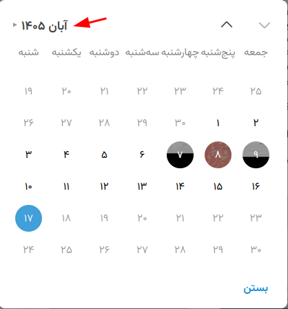
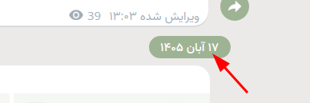
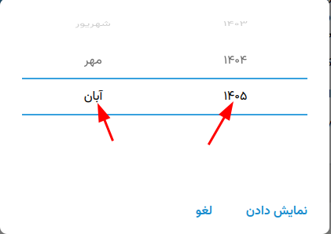

<h1 dir="rtl" align="right">تلگرام جلالی برای لینوکس</h1>

این مخزن نسخه‌ای غیررسمی از تلگرام دسکتاپ است که نمایش تاریخ‌ها را به تقویم جلالی مجهز می‌کند. شمارهٔ نسخه با نسخهٔ اصلی تلگرام دسکتاپ هماهنگ است؛ نسخهٔ فعلی این فورک <strong>۷٫۴٫۱</strong> است.

<h2 dir="rtl" align="right">قابلیت افزوده‌شده</h2>

<ul dir="rtl" align="right">
<li>تاریخ پیام‌های دریافت‌شده و فرستاده‌شده در گفت‌وگوهای دونفره، گروه‌ها و کانال‌ها به جلالی نمایش داده می‌شود.</li>
<li>انتخابگر تاریخ نیز جلالی است: نام ماه، سال و روزهای ماه بر اساس تقویم جلالی نمایش داده می‌شوند.</li>
<li>ترتیب تاریخ به صورت «روز، ماه، سال» است؛ برای نمونه: <strong>۱۷ آبان ۱۴۰۵</strong>.</li>
<li>زمان پیام مطابق ساعت محلی دستگاه نمایش داده می‌شود. تبدیل به جلالی فقط شکل نمایش تاریخ را عوض می‌کند و مقدار زمانی اصلی پیام حفظ می‌شود.</li>
</ul>

<h2 dir="rtl" align="right">نمونه‌های نمایش تاریخ جلالی</h2>

نمایش ماه‌ها و روزهای آن ماه:

نمایش روز، ماه و سال در کنار هر پیام:

انتخاب ماه و سال جلالی:

<h2 dir="rtl" align="right">دریافت نسخهٔ لینوکس</h2>

<a href="https://github.com/afshin-ir/jalali-telegram/releases/tag/v7.4.1">دریافت تلگرام جلالی ۷٫۴٫۱ برای لینوکس</a>

این فورک در حال حاضر فقط برای لینوکس بسته‌بندی می‌شود. فایل فشردهٔ نسخه را دریافت و استخراج کنید؛ سپس فایل <code>Telegram</code> را اجرا کنید.

<pre dir="ltr"><code>unzip Telegram-7.4.1-linux-x86_64.zip -d telegram-jalali
cd telegram-jalali
./Telegram</code></pre>

<h2 dir="rtl" align="right">شماره‌گذاری نسخه‌ها</h2>

شماره‌گذاری این فورک از نسخهٔ اصلی تلگرام دسکتاپ پیروی می‌کند. تغییرات مربوط به تقویم جلالی شمارهٔ نسخهٔ مستقل ندارند؛ بنابراین این انتشار بر پایهٔ تلگرام دسکتاپ ۷٫۴٫۱ با شمارهٔ ۷٫۴٫۱ ارائه می‌شود.

<h2 dir="rtl" align="right">دربارهٔ پروژه و مجوز</h2>

این پروژه فورکی غیررسمی از <a href="https://github.com/telegramdesktop/tdesktop">کد منبع تلگرام دسکتاپ</a> است و وابستگی یا تأیید رسمی از سوی تلگرام ندارد. کد منبع تلگرام دسکتاپ تحت مجوز <a href="https://github.com/afshin-ir/jalali-telegram/blob/dev/LICENSE">GPL نسخهٔ ۳</a> با استثنای OpenSSL منتشر شده است. تغییرات این فورک نیز در همان چارچوب مجوز منتشر می‌شوند.

برای گزارش اشکال یا پیشنهاد، از <a href="https://github.com/afshin-ir/jalali-telegram/issues">بخش درخواست‌ها و اشکال‌های مخزن</a> استفاده کنید.

