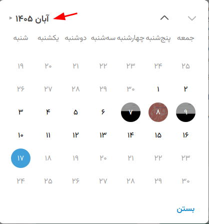
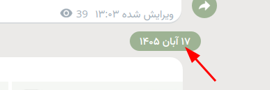
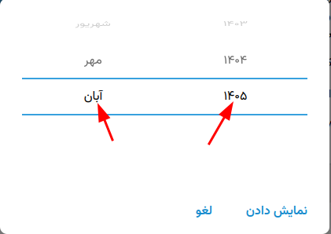

# Telegram Desktop with Jalali Calendar (Linux)

An unofficial Linux fork of [Telegram Desktop](https://github.com/telegramdesktop/tdesktop) that displays dates using the Persian (Jalali/Solar Hijri) calendar. Fork releases follow the upstream Telegram Desktop version number. The current release is **7.4.6**.

## Jalali calendar implementation

The fork keeps Telegram Desktop's existing custom calendar UI; it does not replace it with Qt's calendar widget. Shared formatting helpers use Qt 6's `QCalendar::System::Jalali` to obtain Jalali year, month, and day components from `QDate` values. They provide Persian month names, Persian digit conversion, and day–month–year formatting. A companion helper formats full date-times.

The Jalali conversion is applied across the date-related UI, including:

- Chat-list dates and message dates in private chats, groups, and channels.
- Message timestamps, date separators, tooltips, and edited or forwarded dates.
- Scheduled-message date selection and the custom calendar and month/year pickers.
- Birthdays and profile details, last-seen dates, and active-session dates.
- Other date displays, including saved-media dates.

The underlying timestamps and stored date values are not changed. Jalali conversion is used for display and calendar selection. Dates are shown in **day, month, year** order, for example: **17 Aban 1405**.

## Screenshots

Jalali date beside a message:

Jalali calendar grid:

Jalali month and year picker:

## Download for Linux

[Download Telegram Desktop 7.4.6 with Jalali dates](https://github.com/afshin-ir/jalali-telegram/releases/download/jalali-latest/Telegram-7.4.6-linux-x64.tar.xz)

This fork currently publishes Linux builds only. Extract the downloaded archive and run the `Telegram` executable from the extracted directory.

For the build status, see [GitHub Actions](https://github.com/afshin-ir/jalali-telegram/actions).

## Versioning

Fork version numbers match the corresponding upstream Telegram Desktop release. The current fork release is based on Telegram Desktop **7.4.6**; the Jalali changes do not use a separate version number.

## Upstream changes

See the [upstream Telegram Desktop release notes](https://github.com/telegramdesktop/tdesktop/releases) for changes made by the Telegram Desktop developers.

## License and project status

This is an unofficial fork of [Telegram Desktop](https://github.com/telegramdesktop/tdesktop). It is not affiliated with or endorsed by Telegram. Telegram Desktop is licensed under [GPL-3.0 with the OpenSSL exception](https://github.com/afshin-ir/jalali-telegram/blob/dev/LICENSE); changes in this fork are distributed under the same license.

To report an issue or suggest an improvement, use the [issues page](https://github.com/afshin-ir/jalali-telegram/issues).
